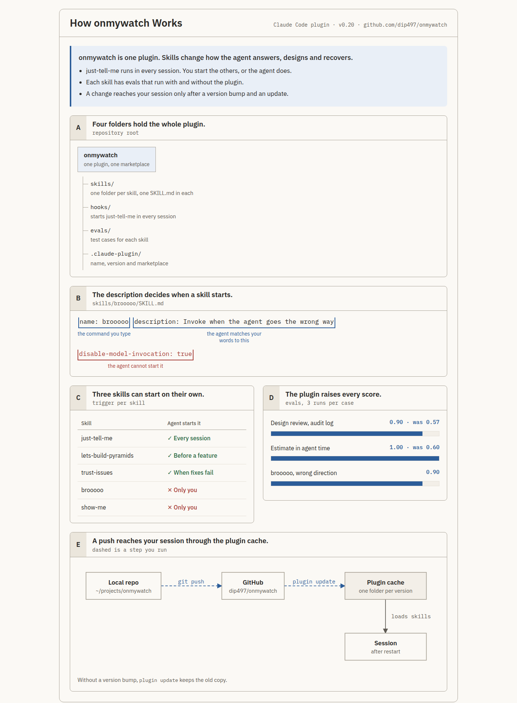

# onmywatch

A small stack of skills for Claude Code that makes coding agents answer straight, think before they build, and own their mistakes.

"Not on my watch": nothing half-designed, unverified or buried in filler gets past.

## Install

Inside Claude Code:

```
/plugin marketplace add dip497/onmywatch
/plugin install onmywatch@onmywatch
```

Or from a terminal:

```
claude plugin marketplace add dip497/onmywatch
claude plugin install onmywatch@onmywatch
```

Restart Claude Code after installing.

To get new versions automatically, turn on auto-update once: `/plugin` → Marketplaces → `onmywatch` → Enable auto-update. Claude Code then updates at startup and asks you to run `/reload-plugins`. To update by hand:

```
claude plugin marketplace update onmywatch
claude plugin update onmywatch@onmywatch
```

## Skills

| Skill | What it does | How it starts |
|---|---|---|
| `/onmywatch` | Entry point. Reads the task and picks the skills below that apply. | You or the agent |
| `/just-tell-me` | Replies lead with the answer, number the steps, say where the work stands and end with one next step. No filler. | On in every session |
| `/talk-is-cheap` | Senior-engineer lens on every code task: data structures and their invariants first, cost stated, simplest thing that holds, root-cause fixes. Adds an architecture note with a refactor shape when the structure around your change is wrong. Checks 13 quality areas and reports the top 3. | On in every session |
| `/trust-me-bro` | A test must guard behaviour against a real bug, not mirror the code. Gates every new test, rejects tests that prove nothing, audits existing ones. | You or the agent |
| `/lets-build-pyramids` | Architecture review before a feature is built: researches how others solved it, looks at it from six views, compares three real designs at today's size, 10x and 100x, and runs a pre-mortem. | You or the agent |
| `/trust-issues` | First-principles redesign: separates facts from inherited choices and habits, then rebuilds the design from the facts. | You or the agent |
| `/next-time-faster` | Run at the end of a long session. Finds the setup and steps that cost time and will come back, then proposes the lightest fix that holds: nothing, a doc pointer, a script, a hook, or as a last resort a skill. Builds only after approval and proves what it builds. | You |
| `/read-my-mind` | Reads your own past sessions in every project, turns each thing you had to point out into a question, and keeps a `mind-reader` agent that asks those questions before work is reported done. Per-project profiles, reads only new sessions on each run, and can update itself after sessions end (`auto on`). Profiles and evidence stay on your machine; the analysis runs through your Claude account like any other prompt. | You |
| `/brooooo` | Press it when a reply did not land or the agent got something wrong. It restates plainly, or owns the mistake and fixes it. | You |
| `/walk-me-through` | Explains how something works and why it is that way: finds the ground truth, follows the real thing step by step, and gives each decision with its source and how sure it is. Works for code, processes, incidents or a session's work. Builds a tabbed page with guided tours through `/show-me` when asked. | You or the agent |
| `/show-me` | Shows the topic instead of explaining it: a text picture or Mermaid in the chat, or an HTML engineering sheet built from a small JSON spec and premade assets (`/show-me sheet`, `/show-me share`). | You |
| `/no-added-comments` | Keeps diffs free of comments the agent added. | You or the agent |

"You or the agent" means you can type it, and the agent also starts it on its own when the task matches.

### Turning always-on skills off

`just-tell-me` and `talk-is-cheap` start in every session.

- For one session: say "stop just-tell-me" or "stop talk-is-cheap".
- For good: fork the repo and delete `hooks/`.

### read-my-mind

```
your sessions ──scan (new lines only)──> your words, per project ──analysts──> signals
                                                                                 │ merge
~/.claude/agents/mind-reader.md  <── reads ── ~/.claude/agent-memory/mind-reader/
   runs before work is "done"                  MEMORY.md (general + index), projects/<repo>.md
        │ notes what it learns                 evidence/, CHANGELOG.md
        └──────────────► inbox ──► next run (by hand, or by the SessionEnd hook when auto is on)
```

1. `/onmywatch:read-my-mind` the first time reads the last 30 days and installs the agent.
2. Run it again, or turn on `auto on`, to read only what is new. A repeat of a known correction counts as a miss and makes that question sharper.
3. `status` shows what was read and what is waiting. `since 7d`, `project <key>` and `rebuild` pick what to read.

Once `~/.claude/agents/mind-reader.md` exists, the SessionStart hook adds one line to every session: run the mind-reader before reporting work as done.

The automatic update runs `claude -p` on haiku (the main run and its subagents) with no transcript of its own, a budget cap (`--max-budget-usd`, default 3) and at most once a day, only after 3 or more sessions changed. Change it with `mind.py config`.

To remove it: `python3 <plugin>/skills/read-my-mind/scripts/mind.py config --auto off`, then delete `~/.claude/agents/mind-reader.md`, `~/.claude/agent-memory/mind-reader/` and `~/.claude/read-my-mind/`.

### show-me sheet



## Evals

Each skill with evals has a folder under `evals/<skill>/<case>/`. A case is either `prompt.md` plus `graders/*.md`, or a `case.yaml` when it needs an earlier conversation (`history.jsonl`) or starting files (`scaffold.sh`). Write the conversation as `history.md` with `## User` and `## Assistant` sections, then convert it:

```
python3 evals/history.py evals/<skill>/<case>/history.md
```

Run one skill's cases:

```
claude plugin eval . --tag lets-build-pyramids --runs 3 --allow-tools WebSearch WebFetch
claude plugin eval . --tag just-tell-me --runs 3 --judge-model sonnet
claude plugin eval . --tag talk-is-cheap trust-me-bro --runs 3 --scaffold --allow-tools Edit Write --judge-model sonnet
claude plugin eval . --tag trust-issues --runs 3 --scaffold --judge-model sonnet
claude plugin eval . --tag next-time-faster --runs 3 --ablation none --judge-model sonnet
claude plugin eval . --tag read-my-mind --runs 3 --scaffold --allow-tools Bash Edit Write Agent --judge-model sonnet
claude plugin eval . --tag brooooo --runs 3 --scaffold --allow-tools Edit Write --judge-model sonnet
```

Latest scores, 3 runs per case:

| Skill | Case | With plugin | Without |
|---|---|---|---|
| `lets-build-pyramids` | Audit log for a multi-tenant SaaS | 0.90 | 0.57 |
| `lets-build-pyramids` | Daily digest email for 50k users | 1.00 | 0.67 |
| `brooooo` | Agent did the opposite of what was asked | 0.90 | n/a |
| `brooooo` | Agent claimed a test passed without running it | 0.83 | n/a |
| `brooooo` | Reply full of jargon | 0.73 | n/a |
| `just-tell-me` | Estimate for a feature, sized in agent time | 1.00 | 0.60 |
| `just-tell-me` | Explain a bug: answer first, under 200 words | 0.89 | 0.83 |
| `just-tell-me` | Unsafe command question, keeps the "no" | 1.00 | 1.00 |
| `just-tell-me` | Vague "make it faster": one short question | 0.67 | 0.33 |
| `just-tell-me` | Partial failure: no invented cause, gives the check | 1.00 | 1.00 |
| `just-tell-me` | Third "still broken": stops and asks for evidence | 0.67 | n/a |
| `just-tell-me` | "Thanks": no invented next step | 1.00 | n/a |
| `trust-issues` | Fourth fix after three failed: names the shared premise first | 0.80 | 0.73 |
| `trust-issues` | Users in two orgs: membership table, not a second column | 1.00 | 0.25 |
| `trust-issues` | Special cases: keeps the rate limit and cites why it exists | 1.00 | 0.44 |
| `trust-issues` | Small change that fits: no ceremony | 0.67 | 1.00 |
| `talk-is-cheap` | Hotfix next to a duplicated rule: small fix plus architecture note | 1.00 | 0.60 |
| `talk-is-cheap` | Review an unbounded cache: top 3 risks only | 1.00 | 0.75 |
| `talk-is-cheap` | Over-built plan for 200 users: clear verdict, simpler design | 0.89 | 0.67 |
| `talk-is-cheap` | Typo question: no lecture | 1.00 | 0.67 |
| `talk-is-cheap` | Session lookup, duplicate finder (both arms pass) | 1.00 | 1.00 |
| `trust-me-bro` | Mirror test, never-failed regression, keep a contract test, write tests | 0.90–1.00 | 0.83–1.00 |
| `next-time-faster` | Server restarted 4 times by hand: proposes a script, drops the one-off migration | 1.00 | n/a |
| `next-time-faster` | `make check` already exists: a pointer, no duplicate | 1.00 | n/a |
| `next-time-faster` | One-off rename: nothing to automate | 1.00 | n/a |
| `next-time-faster` | Weekly triage with repeated rules: a skill, rules kept out of CLAUDE.md | 1.00 | n/a |

`brooooo` has no "without" score: it is a command you type, so it does not exist without the plugin.

## Adding a skill

1. Create `skills/<name>/SKILL.md` with `name` and `description` frontmatter.
2. Add a row to the table above and to `skills/onmywatch/SKILL.md`.
3. Add eval cases under `evals/<name>/<case>/` and tag them with the skill name.
4. Bump `version` in `.claude-plugin/plugin.json`.

## Credits

- `just-tell-me` adapts [i-have-adhd](https://github.com/ayghri/i-have-adhd) by Ayoub Ghriss (MIT), with lessons from [caveman](https://github.com/JuliusBrussee/caveman) by Julius Brussee and [caveman-micro](https://github.com/kuba-guzik/caveman-micro).
- `brooooo` adapts `bro`, and `trust-issues` adapts `principle-redesign-from-first-principles` and `principle-attack-the-premise`, from [pstack](https://github.com/cursor/plugins/tree/main/pstack) by Lauren Tan (MIT).
- `walk-me-through` draws on pstack's `how`, `why` (its confidence tiers) and `teach`, Matt Pocock's `teach` (mission first), Warp's `pr-walkthrough` (separate views with guided tours, sized to the subject) and egonex's `understand-anything`.
- `show-me` draws on [show-me](https://github.com/humanlayer/skills/tree/main/plugins/show-me) by HumanLayer (MIT), the [html-plan](https://github.com/anthropics/claude-plugins-community/tree/main/html-plan) plugin by Thariq Shihipar (MIT), [archify](https://github.com/tt-a1i/archify) by tt-a1i (MIT), Claude's artifact design and diagramming guidance, and Andrej Karpathy's note on asking for STE text, diagrams and HTML instead of prose.
- `talk-is-cheap` adapts the ladder and root-cause rule from [ponytail](https://github.com/DietrichGebert/ponytail) by Dietrich Gebert (MIT), pstack's `model-the-domain` and `foundational-thinking`, and the ISO/IEC 25010 quality model.
- `trust-me-bro` adapts [test-audit](https://github.com/openclaw/openclaw/blob/main/.agents/skills/test-audit/SKILL.md) from openclaw (MIT) and pstack's `principle-test-behavior-not-implementation`.
- `read-my-mind` draws on Claude Code's `/insights` (session analysis) and subagent `memory`, pstack's `reflect` and Matt Pocock's `retro`.
- `next-time-faster` draws on pstack's `reflect` (including its reviewer and synthesizer prompts), `automate-me`, `encode-lessons-in-structure` and `build-the-lever`, and Matt Pocock's `retro`.

## License

[MIT](LICENSE)
